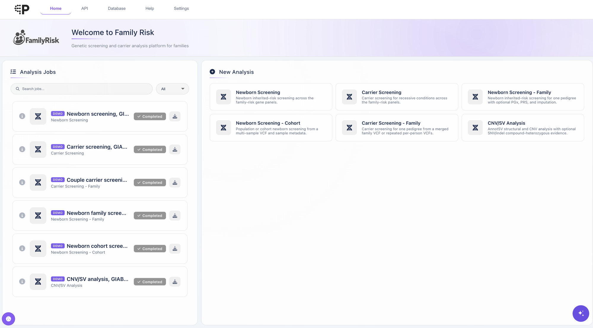

The FamilyRisk homepage is the starting point for all analyses. It can be accessed at [https://www.phenomeportal.org/familyrisk](https://www.phenomeportal.org/familyrisk). No account or registration is needed.

### Navigation Bar
The navigation bar at the top of the page gives access to the main sections of FamilyRisk:

| Tab | Description |
|:----|:------------|
| **Home** | The homepage, where users submit new analyses and review existing analysis jobs. |
| **API** | Information on the FamilyRisk REST API for submitting and retrieving analyses programmatically. |
| **Database** | The FamilyRisk screening knowledge base and the Screening List Generator (see [Database](Database.md)). |
| **Help** | Help and guidance for using FamilyRisk. |
| **Settings** | User settings for the web server. |

### Analysis Jobs
The **"Analysis Jobs"** panel on the left lists all analyses submitted from your browser, together with the public demo analyses. Analyses are linked to your browser's access token and are visible only to you.

- **Search and filter:** jobs can be searched by name in the search box, and filtered by job status via the drop-down menu (default: **All**).
- **Job card:** each job shows its name, analysis type and current status. Clicking a job opens its results.
- **Job status:**

| Status | Description |
|:-------|:------------|
| **Pending** | The job has been created but not yet submitted for analysis. |
| **Queued** | The job has been submitted and is waiting for an available analysis worker. |
| **Running** | The analysis is in progress. |
| **Completed** | The analysis has finished and the results are ready to view and download. |
| **Failed** | The analysis did not finish successfully. |

- **ⓘ** shows the details of the job.
- **Download** (⤓) downloads the results of the job.

#### Demo analyses
Six public demo analyses, marked with a **DEMO** tag, are provided on Genome in a Bottle (GIAB) reference genomes, one for each analysis type. They show the complete output of each analysis without uploading any data, and are a good starting point for new users.

| Demo | Analysis type |
|:-----|:--------------|
| Newborn screening | Newborn Screening |
| Carrier screening | Carrier Screening |
| Couple carrier screening | Carrier Screening - Family |
| Newborn family screening | Newborn Screening - Family |
| Newborn cohort screening | Newborn Screening - Cohort |
| CNV/SV analysis | CNV/SV Analysis |

### New Analysis
The **"New Analysis"** panel on the right is where new analyses are started. Clicking a card opens the submission form for that analysis.

| Analysis | Description | Tutorial |
|:---------|:------------|:---------|
| **Newborn Screening** | Newborn inherited-risk screening for one individual across the FamilyRisk gene panels. | [Newborn Screening - Individual](Newborn-Screening-‐-Individual.md) |
| **Carrier Screening** | Carrier screening for recessive conditions for one individual across the FamilyRisk gene panels. | [Carrier Screening - Individual](Carrier-Screening-‐-Individual.md) |
| **Newborn Screening - Family** | Newborn inherited-risk screening for one pedigree, with optional pharmacogenomics (PGx), polygenic risk score (PRS) and imputation. | [Newborn Screening - Family](Newborn-Screening-‐-Family.md) |
| **Newborn Screening - Cohort** | Population or cohort newborn screening from a multi-sample VCF and sample metadata. | [Newborn Screening - Population](Newborn-Screening-‐-Population.md) |
| **Carrier Screening - Family** | Carrier screening for one pedigree, from a merged family VCF or one VCF per person. | [Carrier Screening - Family](Carrier-Screening-‐-Family.md) |
| **CNV/SV Analysis** | Structural variant and copy number variant analysis with AnnotSV, with optional SNV/indel input to detect compound heterozygosity. | [Newborn Screening - CNV & SV](Newborn-Screening-‐-CNV-&-SV.md) |

### FamilyRiskAI
The purple button (✦) in the bottom-right corner opens **FamilyRiskAI**, the AI chatbox of FamilyRisk (see [FamilyRiskAI](FamilyRiskAI.md)). Through natural-language conversation, it helps users explore the screening knowledge base, build customized screening lists and set optional filtering options, quickly pinpoint variants of interest, and summarise and explain the variants found.

!! Note
    FamilyRisk and FamilyRiskAI do not provide a diagnosis, prognosis or treatment recommendation. All screening findings need confirmation and interpretation by a genetic counselor or clinical geneticist.
